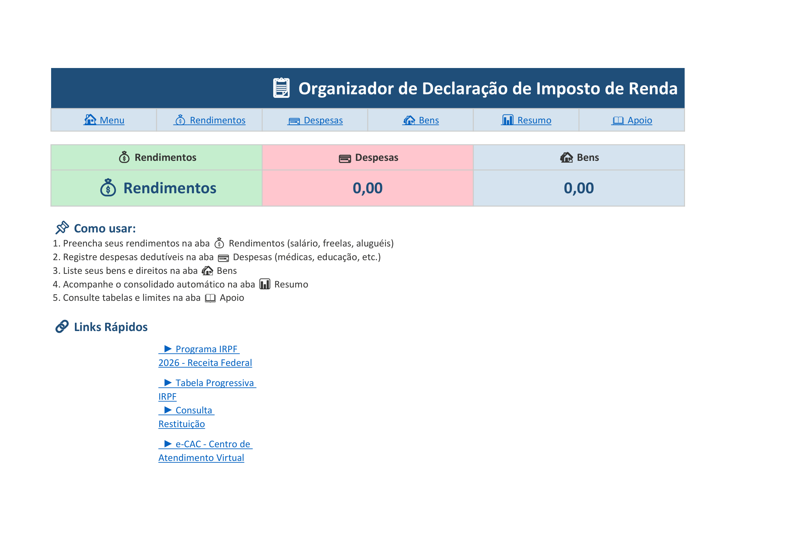
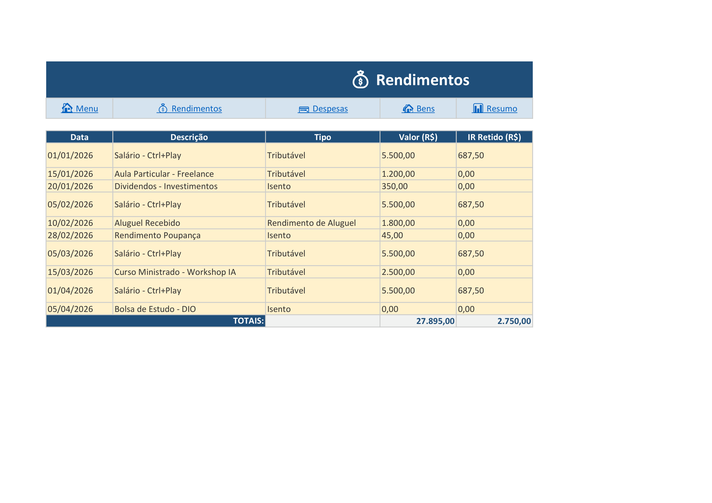
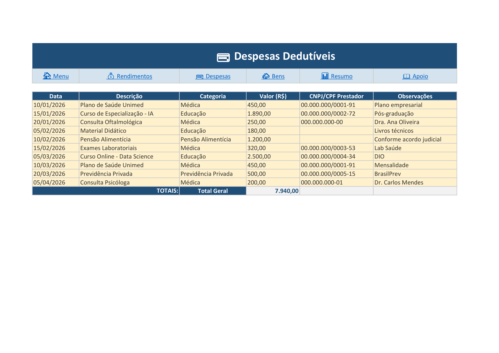
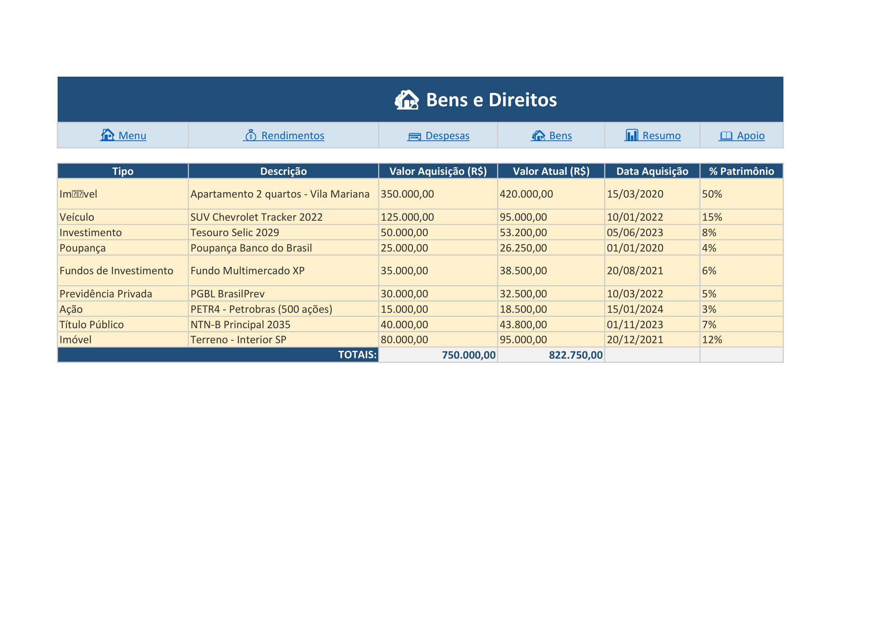
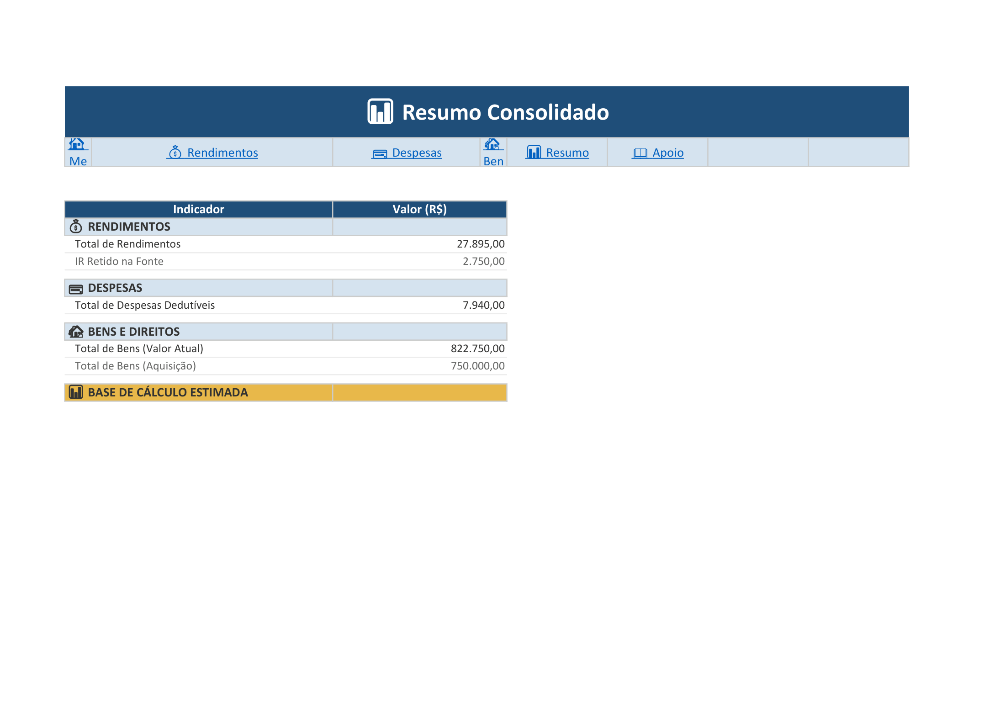
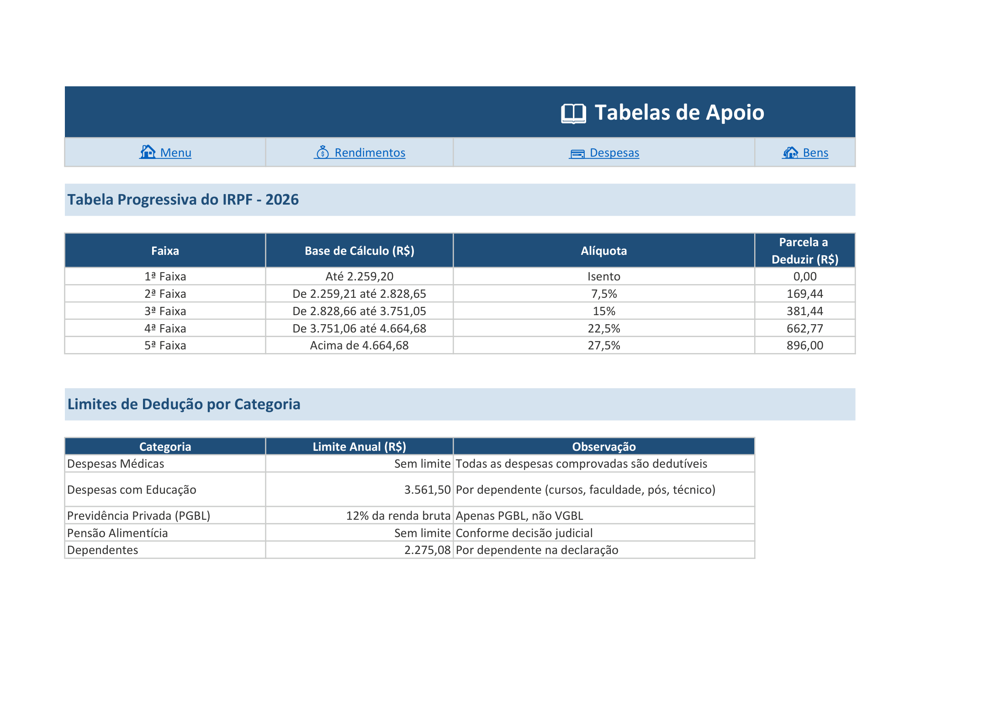

# 📋 Organizador de Declaração de Imposto de Renda


> **Desafio de Projeto** — Formação Análise de Dados com Excel e IA | [Digital Innovation One](https://www.dio.me/)

## 📌 Sobre o Projeto

Este projeto consiste em uma **planilha no Excel** para organizar e consolidar informações essenciais para a **Declaração de Imposto de Renda Pessoa Física (IRPF)**. A ferramenta funciona como um agregador de dados fiscais, permitindo que o contribuinte controle seus rendimentos, despesas dedutíveis e bens patrimoniais em um só lugar, com validações automáticas e navegação facilitada.

### 🎯 Objetivos de Aprendizagem

- Aplicar conceitos de **Excel** em um cenário prático e fiscal
- Utilizar **validações de dados**, **fórmulas** e **intervalos nomeados**
- Construir uma interface com **navegação** entre abas via hyperlinks
- Documentar o processo técnico de forma estruturada no **GitHub**

## 🛠️ Funcionalidades

| Funcionalidade | Descrição |
|----------------|-----------|
| **📊 Dashboard** | Menu principal com cards de resumo automático (rendas, despesas, bens) |
| **💰 Rendimentos** | Controle de rendimentos tributáveis, isentos e de aluguel |
| **💳 Despesas** | Registro de despesas dedutíveis com categorias pré-definidas |
| **🏡 Bens** | Gestão de bens e direitos com valor de aquisição e valor atual |
| **📊 Resumo** | Consolidação automática com fórmulas SUM, SUMPRODUCT e referências entre abas |
| **📖 Apoio** | Tabela progressiva IRPF 2026, limites de dedução e links úteis |
| **✅ Validações** | Listas dropdown para tipos de rendimento, categorias de despesa e tipos de bem |
| **🔗 Navegação** | Hyperlinks entre todas as abas para acesso rápido |
| **📈 Cálculos** | Totais automáticos, IR retido, base de cálculo estimada |

## 📁 Estrutura da Planilha

```
📋 Organizador IRPF.xlsx
├── 🏠 Menu          → Dashboard com cards de resumo + navegação
├── 💰 Rendimentos   → 10 registros de exemplo (salário, freelance, dividendos)
├── 💳 Despesas      → 10 registros de exemplo (médicas, educação, previdência)
├── 🏡 Bens          → 9 registros de exemplo (imóveis, veículos, investimentos)
├── 📊 Resumo        → Consolidado automático com fórmulas
└── 📖 Apoio         → Tabela IRPF, limites de dedução, links oficiais
```

## 🧮 Fórmulas Utilizadas

| Fórmula | Aplicação |
|---------|-----------|
| `SUM()` | Soma total de rendimentos, despesas e bens |
| `SUMPRODUCT()` | Filtro de rendimentos/despesas por categoria (tributável, isento, médica, educação) |
| `=Abase!Referência` | Referência entre abas para consolidar dados no Resumo |
| `DataValidation` | Listas dropdown para categorias e tipos |

## 📸 Capturas de Tela

### Menu Principal


### Rendimentos


### Despesas Dedutíveis


### Bens e Direitos


### Resumo Consolidado


### Tabelas de Apoio


## 🚀 Como Usar

1. **Baixe** o arquivo [`organizador-irpf.xlsx`](organizador-irpf.xlsx)
2. **Abra** no Microsoft Excel (recomendado) ou LibreOffice Calc
3. **Habilite** o conteúdo (se houver aviso de segurança)
4. **Substitua** os dados de exemplo pelos seus:
   - 💰 Aba **Rendimentos** — insira seus rendimentos do ano
   - 💳 Aba **Despesas** — registre gastos dedutíveis
   - 🏡 Aba **Bens** — liste seu patrimônio
5. **Acompanhe** o consolidado na aba **Resumo**
6. **Consulte** limites e alíquotas na aba **Apoio**

> 💡 **Dica:** Células em **amarelo** são para preenchimento manual. Células em **cinza** são calculadas automaticamente.

## 🧰 Tecnologias

- **Microsoft Excel** (planilha com fórmulas, validações e hyperlinks)
- **Python + openpyxl** (geração automatizada da planilha)
- **Git & GitHub** (versionamento e entrega)

## 📝 Licença

Este projeto é um **desafio educacional** da DIO — conteúdo livre para estudo e portfólio.

---

⌨️ com 💜 por **Ever Ferreira** | [](https://linkedin.com/in/evermaria) [](https://github.com/everferreira)
